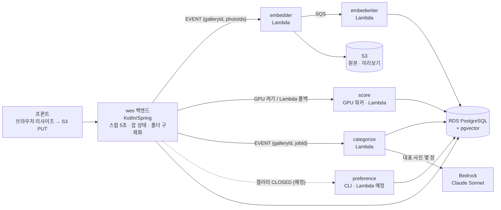

# organic-agent-ai

웨딩 사진 셀렉 서비스의 **AI 서버**다. 작가가 촬영한 수천 장을 부부가 고르고, 보정을 요청하고, 앨범을 구성하는 과정에서
**작가의 업무 시간을 줄이는** AI 기능을 맡는다.

> AI 는 초안·구조화·제안만 하고, **최종 결정(사진 선택·제출·보정 확정)은 언제나 사람이 한다.**

| | |
|---|---|
| 역할 | 갤러리 전수 모델 추론(임베딩·점수·그룹) + 선호 학습. 사용자 기능(추천·비교샷·보정 요청 구조화)은 메인 백엔드가 저장된 숫자로 수행 |
| 실행 모양 | 최상위 디렉토리 하나 = 배포 단위 하나. Lambda 컨테이너 4개 + GPU 워커(EC2) + Vercel 서비스 1개 |
| 스택 | Python 3.12 · PyTorch(DINOv3 · CLIP · ARNIQA) · PostgreSQL + pgvector · AWS(Lambda · S3 · SQS · EC2 g6 · Bedrock Claude) |
| 규모 | 모듈 6개 · 테스트 약 220개 · 이슈 150여 건(2026-08 ~) |

---

## 1. 무엇을 하나

갤러리 하나(수천 장)가 업로드되면 세 단계로 처리한다.

1. **사진마다 한 번** — 미리보기 JPEG 를 만들고, DINOv3·CLIP 임베딩과 품질·미학 점수·피사체·라벨을 계산해 DB 에 적재한다.
2. **갤러리마다 한 번** — 저장된 숫자만으로 연사(연속 촬영) 묶음 → 촬영 시각 구간 → **컨셉 폴더(1층)** → 세부 그룹(2층)을 만들고,
   Bedrock(Claude)이 대표 사진 몇 장을 보고 이름을 붙인다.
3. **갤러리가 마감될 때** — 부부의 최종 선택으로 "이 스튜디오의 선호" 가중치를 학습하고, 홀드아웃 게이트를 넘은 모델만 추천에 붙인다.

**원가 원칙** — 갤러리 전수 처리는 경량 모델(DINOv3 · CLIP · ARNIQA), LLM 은 갤러리당 몇 번의 소규모 호출에만 쓴다.
갤러리 하나당 Bedrock 호출은 1층 1회 + 2층 수 회다.

---

## 2. 시스템에서의 위치

메인 백엔드 **wes**(Kotlin/Spring, 별도 저장소)가 업로드·갤러리·셀렉 도메인을 소유한다. 이 저장소는 wes 가 트리거하는 **배치 워커**이고,
결과는 HTTP 응답이 아니라 **공유 PostgreSQL 에 직접 쓴다**. 두 저장소 사이에는 데이터를 나르는 API 가 없다 — **DB 테이블이 곧 인터페이스**다.



경계 규칙은 하나다 — **"갤러리 전수에 torch 모델 추론이 필요한가?"** 그렇다면 이 저장소, 아니면 wes 다.
wes 도 저장된 점수와 미리보기 몇 장을 읽어 Bedrock 에 보낸다(폴더별 추천·비교샷·보정 요청 구조화).

---

## 3. 모듈

| 디렉토리 | 무엇을 하나 | 모델 | 배포 |
|---|---|---|---|
| [`embedder/`](embedder/README.md) | 원본을 열어 EXIF 를 읽고 미리보기 JPEG(1024px)를 S3 에 올린 뒤 **그 파일로** DINOv3 임베딩 | DINOv3 ViT-B/16 | Lambda (VPC 밖) |
| [`embedwriter/`](embedwriter/README.md) | embedder 결과를 SQS 로 받아 **한 트랜잭션에 수백 장씩** DB 적재 | 없음 | Lambda (VPC 안, 동시 ≤ 2) |
| [`score/`](score/README.md) | 사진별 미학·화질·선명도 점수, 피사체(신부·신랑·커플·단체), 라벨 8개(눈감김·미소·베일·부케·구도…) | CLIP ViT-L/14 · ARNIQA · LAION 미학 MLP | **GPU 워커**(EC2 g6.xlarge) + Lambda 폴백 |
| [`categorize/`](categorize/README.md) | 백분위 · 연사 묶음 · 시각 구간 → 컨셉 폴더(1층) · 세부 그룹(2층) · 이름 짓기 | numpy · scipy · Bedrock (**torch 없음**) | Lambda |
| [`preference/`](preference/README.md) | 부부의 최종 선택으로 선호 가중치(스칼라 11 + 임베딩 1536) 학습, 홀드아웃 게이트 | 로지스틱 회귀 (scipy) | CLI (Lambda 연결은 2단계) |
| `notionchat/` | 팀 Notion 을 도구로 쓰는 사내 챗봇. 워크스페이스 지도 + 골든 셋 회귀 | Claude (Bedrock), FastAPI, SSE | Vercel |

배치 모듈 다섯은 **같은 모양**이다 — `controller/handler.py`(Lambda)와 `__main__.py`(로컬 CLI)가 같은 `service/job.run()` 을 부르고,
모듈마다 자기 `requirements.txt` · `Dockerfile` · `deploy.sh` · `tests/` 를 갖는다. 로컬에서 실제 S3·RDS 를 상대로 같은 코드를 검증한 뒤 배포한다.

---

## 4. 분석 파이프라인

```
[프론트]  50장 리사이즈 → S3 PUT → photos.status = UPLOADED
   │
   ▼ wes 스윕 5s — 배정(photos.dispatched_at) · 잡 상태(ANALYZING → CATEGORIZING → DONE) · GPU 켜기/폴백
   │
   ├─ 임베딩 없는 사진 50장씩 ──▶ [embedder]  원본 GET → EXIF → 회전·1024 JPEG → S3 PUT → 그 바이트로 DINOv3
   │                                  └─ 8장 = SQS 메시지 하나 ──▶ [embedwriter]  unnest 한 문장으로 photo_analysis · photos 적재
   │
   ├─ 점수 없는 사진 ──▶ [score GPU 워커]  SKIP LOCKED 32장 집기 → CLIP · ARNIQA · 고전 지표(fp16) → commit(= 잠금 해제)
   │                      1단계 CLIP·피사체(폴더가 기다림) 먼저, 2단계 화질 점수(추천만 씀)는 뒤에
   │                      유휴 30초 → 자기 StopInstances.  GPU 를 못 켜면 같은 코드가 Lambda 폴백으로
   │
   └─ 전부 점수 있음 ──▶ [categorize]  DB 만 읽음 → 백분위 · 연사(코사인 ≥ 0.96 ∧ 시각 창) · 시각 공백 5분 구간
                                      → 구간 대표 4장 타일 → Bedrock "같은 컨셉끼리 묶고 이름" (1층)
                                      → 1층 안 DINOv3 ⊕ CLIP 계층 클러스터 (2층) → 2층 이름 → concept_assignments
                                      실패하면 ai_analysis_jobs.error 한 컬럼만 — 상태 전이는 wes 가
```

페이로드는 두 모양뿐이다. embedder·score 는 `{"galleryId", "photoIds"}`, categorize 는 `{"galleryId", "jobId"}`.
이 저장소 안에는 **체인·샤딩·자기 재호출·조정자가 없다** — 누구를 언제 부를지는 전부 wes 가 정한다.

---

## 5. 설계 결정 — 왜 이렇게 만들었나

| 문제 | 결정 | 얻은 것 |
|---|---|---|
| 갤러리 잠금·샤딩·체인·자기 재호출이 세 모듈에 흩어져 상태가 꼬였다 | **v2: 대상 선정·잠금·상태는 wes 하나가 소유**, Lambda 는 받은 사진만 처리해 DB 에 쓴다 | 모듈마다 수백 줄 삭제, 재시도·실패 경로가 한 곳(wes 스윕)에 |
| 벡터는 있는데 미리보기가 없는 사진이 생길 수 있었다 | **S3 PUT 을 먼저, 올라간 JPEG 바이트로 임베딩** (순서가 계약) | 화면 픽셀과 벡터가 같은 파일. 장당 수십 ms 재디코드를 감수 |
| Lambda 32 샤드로 점수를 내면 느리고 비쌌다 | **GPU 워커가 사진 단위로 `SKIP LOCKED` 집기**, 유휴면 스스로 인스턴스 정지. Lambda 는 폴백 | 7,189장 9.7분 / $1.53 → 3.9분 / $0.063. 워커가 죽으면 롤백으로 행이 자동 반환 |
| 동시 임베더 72개가 8장마다 각자 INSERT 해 DB 시간의 57% 를 먹고 사용자 요청을 굶겼다 | **결과를 SQS 로 모아 embedwriter(동시 ≤ 2)가 수백 장 / 트랜잭션** 으로 적재. embedder 는 VPC 밖, DB 없음 | 쓰기 세션 72 → 2, 메시지 실패는 `ReportBatchItemFailures` 로 건별 재시도 |
| 폴더는 CLIP 만 있으면 되는데 ARNIQA(화질)까지 기다렸다 | **score 를 두 단계로** — 1단계 CLIP·피사체를 먼저 집고 2단계 화질은 찜 표시(lease) 후 잠금 없이 계산 | 폴더 생성 대기 단축. 잠근 채 계산하면 categorize 적재 16초 → 95초였던 것을 회피 |
| 고정 카테고리 목록(드레스·한복…)은 스튜디오마다 다른 컨셉을 못 맞췄다 | **촬영 시각 공백으로 구간을 자르고 VLM 이 자유 이름을 짓는다**. 시각이 없으면 DINOv3 Ward 로 대체 | 멘토 라벨 대비 1층 ARI 0.32 → **0.94** |
| 품질 점수로 하드 필터링하면 작가가 의도한 흔들림·눈감김 컷이 사라진다 | 점수는 **순위·백분위 신호**로만. `photo_ratings`(개인 취향)는 정책상 AI 입력 금지 | 사람이 결정권을 잃지 않는다 |
| 스키마를 두 저장소가 고치면 어긋난다 | **마이그레이션은 wes Flyway 만**. 이 저장소는 컬럼 소유권을 UPSERT 의 SET 절로 강제(score 는 점수 컬럼만, categorize 는 그룹 컬럼만) | 모듈 간 계약은 상수 + 서로의 설정을 파싱해 비교하는 테스트가 지킨다 |

구조나 모델 결과를 바꾸는 개선은 **드라이버 → 기준선 측정 → 대안 → ADR → 전/후 검증** 순서로 진행한다(`.claude/rules/design-method.md`).
추천·분류 숫자는 항상 무작위·단순 규칙 기준선과 같은 표에 둔다 — 기준선을 못 이기면 개선이 아니다.
예: 선호 학습 1단계는 홀드아웃 게이트(부호 검정 p<0.05 · 악화 비율 ≤ 30%)를 아직 넘지 못해 **학습만 하고 추천에는 붙지 않는다**.

---

## 6. 실측

| 항목 | 전 | 후 |
|---|---|---|
| 전체 분석 체인 (7,189장) | 40분 이상 | Lambda 32 샤드 13.7분 (embedder 2.6 · score 9.8 · categorize 1.1) |
| 점수 계산 (같은 7,189장) | Lambda 32 샤드 9.7분 · $1.53 | EC2 g6.xlarge 워커 3.9분 · $0.063 (콜드 16초, 장당 연산 1.45s → 0.021s) |
| GPU fp16 전환 검증 (7,189장 전수) | CPU fp32 | 순위 상관 technical 1.0000 · aesthetic 0.9999, CLIP 코사인 최소 0.9998 |
| 컨셉 폴더(1층) 정확도 (ARI, 멘토 라벨) | 고정 목록 0.32 | 시각 구간 + VLM 0.94 |
| categorize 계층 클러스터 거리 행렬 | 37초 | BLAS 행렬곱 ≈ 1초 |
| categorize 이름 짓기 (Bedrock) | 직렬 25초 | 1층별 병렬 ≈ 18초 |
| ARNIQA 입력 긴 변 | 1600px | 1024px — 연산 1/2.4, 순위 상관 0.93 유지 |
| 임베딩 적재 DB 세션 | 동시 72 | SQS → embedwriter 동시 ≤ 2 |

---

## 7. 코드 구조와 개발 방식

**층 구조** — 다섯 배치 모듈 모두 `controller → service → repository · infrastructure`, 전부가 `domain · config` 를 본다. 의존은 한 방향이다.
torch 는 `infrastructure/` 에서만 import 하고, categorize 는 torch 를 import 하지 않음을 테스트로 고정한다.

```
<module>/<module>/
├── __main__.py       로컬 CLI
├── controller/       Lambda 진입 · 페이로드 검증
├── service/          배치 본체 · 파이프라인 · 워커 루프
├── domain/           dataclass · 프로토콜 — 로직 없음
├── repository/       Postgres · S3 · SQS
├── infrastructure/   모델 로드·추론 (torch) · Bedrock 클라이언트 · EC2
└── config/           Settings.from_env() — 코드 어디서도 os.environ 을 직접 만지지 않는다
```

**테스트** — 모델·DB 없이 돈다(가짜 러너·가짜 커넥션). 재개·데드라인·컬럼 경계·배치 실패 격리·handler 계약·모듈 간 상수 일치를 고정한다.

| embedder | embedwriter | score | categorize | preference | notionchat |
|---|---|---|---|---|---|
| 64 | 23 (+ 실제 pgvector 로 SQL·권한 검증 2) | 50 | 63 | 13 | 8 (+ 골든 셋 17문항) |

**CI/CD** — `main` 에 머지되면 **바뀐 디렉토리의 `deploy.sh` 만** 돌아 ECR 푸시 + Lambda 코드 갱신(GitHub Actions, OIDC).
`score/**` 가 바뀌면 GPU 워커 이미지(`:gpu` · `:gpu-<sha>`)도 함께 빌드한다. `notionchat/**` 은 Vercel 로 나간다.
로컬에서 손으로 하는 배포와 같은 스크립트라 두 경로가 어긋나지 않는다.

**작업 규칙** — 이슈·브랜치·PR 은 **모듈 하나**만 다룬다. 제목 `[<모듈>] <타입>: <한글 설명>(#이슈)`, squash 머지.
이슈·PR 본문은 "맨 위 한 줄 요약 / 왜 / 무엇을(전→후 표) / 어떻게 확인했나" 로 쓴다(`.claude/rules/`).

---

## 8. 로컬 실행

```bash
# embedder — 미리보기 + DINOv3
cd embedder && python -m venv .venv \
  && .venv/bin/pip install torch torchvision --index-url https://download.pytorch.org/whl/cpu \
  && .venv/bin/pip install -r requirements.txt
.venv/bin/python -m embedder --gallery-id 1 [--photo-ids 1,2,3]
.venv/bin/python -m pytest tests -q

# score + categorize — 한 venv 에 둘 다 (Python 3.12, torch 2.4.1 핀)
cd score && uv venv --python 3.12 .venv && uv pip install --python .venv/bin/python \
  -r requirements.txt -r ../categorize/requirements.txt --no-deps -e . -e ../categorize
.venv/bin/python -m score --gallery-id 12 [--photo-ids 1,2,3]      # 사진별 점수
.venv/bin/python -m score worker --gpu --once --no-idle-stop       # GPU 집기 워커 한 배치
cd ../categorize && ../score/.venv/bin/python -m categorize --gallery-id 12 --job-id J   # 폴더 · 이름 (Bedrock)
```

DB·S3 접속은 환경변수(`DB_*`, `S3_BUCKET`)로 넣는다. 각 모듈 README 에 변수 표와 로컬 pg · RDS 터널 경로가 있다.
갤러리 하나를 임베딩 → 점수 → 폴더까지 한 번에 돌리는 스크립트는 wes 쪽 `scripts/local-ai.sh` 다.

---

## 9. 관련 저장소

| 저장소 | 역할 |
|---|---|
| `organic-agent-server` (wes) | 메인 백엔드 (Kotlin/Spring). 스키마(Flyway) · 잡 상태 · 추천 · 사용자 기능 |
| `organic-agent-test-web` | 프론트. 앨범 에디터 · 브라우저 리사이즈 업로드 |
| `organic-agent-infra` | Terraform. VPC · RDS · S3 · SQS · Lambda · GPU 인스턴스 |
